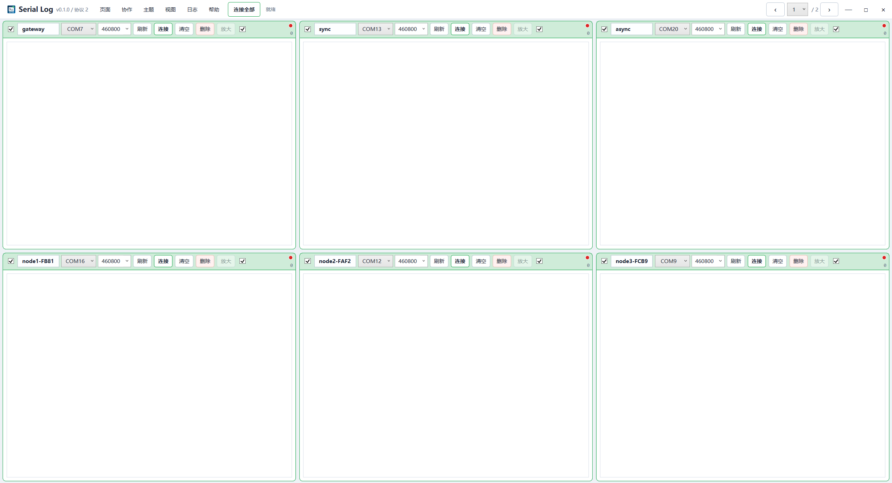
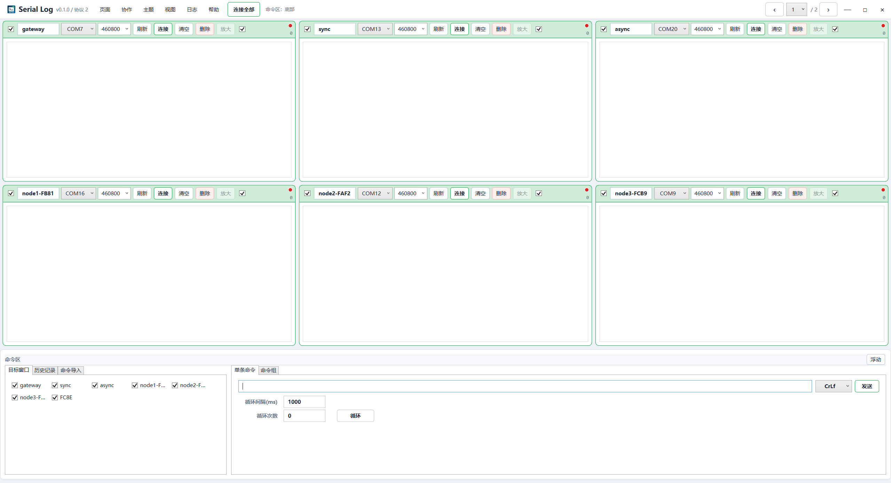

# Serial Log 使用说明

在线版本：[https://wangjingping-88.github.io/serial-log/help/](https://wangjingping-88.github.io/serial-log/help/)

## 界面概览

Serial Log 是基于 .NET 8 WPF 的 Windows 多串口日志工作台。标题栏集中提供“页面、协作、主题、视图、日志、帮助”和“连接全部”入口，主工作区用于排列串口窗口，命令区可按需显示或隐藏。





## 安装与启动

推荐下载 Release 中的便携版 `SerialLog-*-win-x64-portable.zip`，解压后运行 `SerialLog.App.exe`。便携版不需要安装证书。

MSIX 需要先将随包提供的 `.cer` 安装到当前用户的“受信任的人员”，再安装 `.msix`。

## 标题栏菜单

- **页面**：新增页、删除空白页、循环切换上一页或下一页、直接跳转。标题栏右侧同时提供常驻分页控件。
- **协作**：选择本地、主机或从机模式，设置本机名称、主机地址、端口和启动状态。
- **主题**：选择预设颜色或使用 Windows 调色板自定义主题色。
- **视图**：设置命令区停靠在上、下、左、右，或显示、隐藏、浮动。
- **日志**：设置日志根目录、浏览目录、新建日志会话，并打开当前会话日志目录。
- **帮助**：打开在线操作说明、检查更新、设置快捷键、查看版本。
- **连接全部 / 断开全部**：连接所有可连接窗口，或断开所有已连接窗口；单个窗口失败不会阻止其他窗口执行。

标题栏右侧状态文字会反馈最近一次页面、连接、协作、日志等操作结果。

打开任一标题栏菜单后，将鼠标横向移动到其他菜单可直接切换，无需先关闭当前菜单。

## 串口窗口

每个窗口提供：

- 左侧复选框：是否作为命令发送目标。
- 窗口名称：可编辑，例如 `gateway`、`sync`、`node1`。
- 端口：选择本机 COM 口。
- 波特率：常用波特率下拉选项，也可直接输入自定义值。
- 刷新：重新扫描串口。
- 连接 / 断开：控制当前本地串口。
- 清空：清除界面日志并恢复自动跟随，不删除磁盘文件。
- 删除：确认后删除窗口。
- 放大 / 还原：改变当前窗口占用的网格高度。
- 右侧复选框：本地窗口是否自动保存日志。

拖动窗口菜单栏的空白区域可调整顺序或跨页移动。工作区空槽中的“+”会在点击位置创建新窗口。

远端窗口在从机侧只读，不可用操作会置灰；主机侧仍可向从机窗口发送命令。

## 页面管理

每页最多显示 `3 x 2` 个窗口。超过六个窗口时可新建页面。上一页和下一页支持循环切换，也可通过页面菜单直接跳转。

默认使用 `Left` 和 `Right` 翻页；标题栏右侧的上一页、页码下拉和下一页控件可直接循环翻页或跳转到指定页面。

## 日志查看

- 界面时间戳显示时分秒和毫秒，保存文件包含完整年月日。
- ANSI 控制序列会解析为颜色显示，写入文件时移除控制字符。
- 每个窗口界面最多保留 5000 行，超出后移除最早的界面行；磁盘日志不受影响。
- 鼠标滚轮滚动会暂停自动跟随。
- 日志窗口获得焦点后按 `Enter` 跳到最新并恢复跟随。
- 支持选择任意行、右键复制、`Ctrl+A` 全选和 `Ctrl+C` 复制。
- 清空日志后自动恢复跟随。

## 日志保存与会话

默认日志根目录：

```text
D:\serial-log-data\logs
```

同一日志会话只创建一个会话目录，所有参与保存的本地及远端窗口写入该目录。点击“日志 → 新建会话”后会创建新目录，已经连接的窗口也会把后续日志切换到新会话。

选择“日志 → 当前会话日志”可在文件资源管理器中直接打开当前会话目录。

目录格式：

```text
日志根目录\yyyy-MM-dd\yyyyMMdd_HHmmss_fff\
```

单个日志文件达到 100 MB 后自动创建 `_001`、`_002` 等分段文件。

同一会话内取消后重新勾选自动保存，将从新的编号文件继续写入；取消自动保存期间收到的日志不会补写。

“日志”菜单中的“无数据自动重连”默认设置为 `0`（关闭）。低频日志设备建议保持关闭；只有明确需要按静默时间重开串口时，才设置非零秒数。串口读写异常仍会按原逻辑进入自动重连。

## 命令区

命令区左侧包含目标窗口、历史记录和命令导入，右侧包含单条命令和命令组。命令区可停靠、浮动或完全隐藏。

### 单条命令

1. 选择目标窗口。
2. 输入命令。
3. 选择 `None`、`Cr`、`Lf` 或 `CrLf`。
4. 点击发送，或设置循环间隔和循环次数后循环发送。

循环次数 `0` 表示不循环、只执行一轮，正数表示总执行轮次；只有勾选“无限循环”才持续发送。勾选时次数输入置灰，循环间隔 `0` 只表示不等待。命令组采用同样的规则。

仅已连接且允许发送的目标会执行命令。

默认开启“解析转义字符”。例如输入 `at+wiotasend=10000,12\r\n0123456789`，会在一次串口写入中发送命令、实际 CRLF 和后续数据；若不需要在数据末尾附加换行，将右侧换行方式设为 `None`。关闭解析开关会原样发送反斜杠字符。

“日志 → 本地发送回显”控制发送成功后是否在目标日志显示 `[发送]` 命令，设置随当前工作区保存；Ymodem 二进制包不会回显。

### 命令组

“命令组”内部支持多个命名分类页签，例如“全部／AP设备／IOT设备”，外层仍保留单条命令和 Ymodem。设置窗口可增删改名及调整列表顺序，通过“成员设置”搜索和多选命令组，单个组也可勾选多个所属列表。同一组共用命令、目标和运行状态；在命名列表中移除成员或清空，只移除分类关系，不删除原组和队列。没有分类的组仍可在“全部”找到。“全部”不可改名、删除，不再自动创建“默认列表”，可以删除所有命名分类。旧预览的自动默认分类会备份后移除，命令和队列保留；用户已重命名的分类不受影响。设置窗口放大至 1320×920，并按屏幕工作区适配；普通设置无页面滚动条，小屏仍可滚动查看全部控件。

点击“命令组设置”打开二级编辑窗口，编辑名称、独立目标、命令、换行符、转义解析、组内间隔、循环间隔和循环次数；支持新建、复制、删除、跨工作区导入。命令组的上移／下移只在设置窗口中操作，保存后更新外层顺序。组内命令可双击或右键编辑、复制、删除，拖动调序。

设置窗口中的命令组列表常显，移动后保持选中项可见，并显示当前序号。“智能分组”按完全相同的目标窗口集合归并排列，忽略勾选顺序和窗口名称；同类保留原顺序，未选目标的组置后。不合并命令组、不修改执行队列，保存设置后才生效。

外层列表每组只占紧凑的一行，显示名称、参数摘要和状态，行尾仅保留“运行／入队”。分类与工具按钮共用一行，数量跟在标题后。命名列表通过 Delete 或右键仅移除成员；“全部”中确认后删除原命令组。“运行”按组配置次数执行；并行运行及停止组任务仅针对当前列表，同一组不会重复并行启动。不同串口可并行，同一串口冲突会立即提示，不隐式等待。切换列表不停止已启动的任务，当前工作区共用执行队列。

双击组名称、摘要、状态等非勾选区域，直接进入命令组设置并定位该组，不改变勾选状态。勾选框和“运行／入队”按钮保留原操作，列表空白或执行队列不会打开编辑。

点击组的“入队”按添加顺序执行，可重复加入同一组；队列条目通过 `Delete` 或右键“删除”，不显示删除及上下移动按钮。每项执行该组配置的循环次数。次数 `0` 表示不循环、只执行一轮，允许入队；勾选“无限循环”的组入队按钮置灰，悬停可查看原因。间隔 `0` 只表示轮次间不等待。列表的“无限循环”是配置摘要，“就绪”表示尚未执行。

外层不提供命令组列表的批量清空。进入“命令组设置”，通过顶部“清空列表”确认后修改草稿，保存后才生效，取消不改变原组和队列。命名列表仅清空成员关系；“全部”清空空闲命令组及其队列引用，保留运行中或被运行队列引用的组。设置窗口左侧参数、右侧命令列表各占一半。执行队列底部的“清空”继续保留，只清空队列，不删除组。队列运行中先停止再增删或清空条目；遇到失败或冲突停止后续条目。

切换工作区、隐藏或浮动命令区不停止任务。设置窗口修改在保存后生效，已启动的组和队列继续使用开始时的配置快照。详见 [命令组与发送说明](command-groups.md)。

### AT 命令导入

支持普通文本、字面量 `\r\n`，以及 `.c/.h` 文件中的 `AT_CMD_EXPORT(...)`。支持覆盖导入、追加去重、自定义编辑、填入单条命令和填入命令组。

## 多机协作（协议 2）

协作采用主机中继，不建立从机之间的直接连接。

1. 主机在“协作”中选择“主机”，填写本机名称、地址和端口后启动。
2. 其他电脑选择“从机”，填写主机 IPv4 地址和相同端口后连接。
3. 主机缓存并转发自身及所有在线从机的窗口快照与实时日志。
4. 新加入的从机会立即获得主机和已有从机的完整快照。

行为约定：

- 每台电脑不显示自己的镜像窗口。
- 主机可查看并控制从机窗口。
- 从机可查看主机和其他从机，但远端窗口只读。
- 所有接收的远端日志默认保存到本机日志会话。
- 成员断线后窗口标记离线，重连后按原位置恢复。
- 所有电脑必须使用相同的协议 2，新旧版本不混用。
- Windows 防火墙需要允许主机监听端口。

## 主题与滚动条

主题色控制标题栏菜单高亮、串口窗口边框和滚动条。可选择预设颜色，也可打开 Windows 调色板自定义颜色。

滚动条默认保持细窄，鼠标悬停后加宽，不挤压日志内容。

缩小主窗口时，菜单、控件和布局会按比例缩放，并限制最小缩放比例；日志文字保持原字号，避免缩小后难以阅读。

## 快捷键

在“帮助 → 快捷键”中可修改、清除或恢复默认值。保存前会检查可配置快捷键之间及与固定快捷键的冲突。

| 功能 | 默认快捷键 |
|---|---|
| 打开操作说明 | `F1` |
| 新增页面 | `Ctrl+N` |
| 删除当前页 | `Alt+Delete` |
| 上一页 / 下一页 | `Left` / `Right` |
| 新增串口窗口 | `Alt+P` |
| 连接 / 断开当前窗口 | `Ctrl+L` |
| 连接 / 断开全部 | `Alt+L` |
| 暂停 / 恢复当前窗口日志跟随 | `Ctrl+S` |
| 暂停 / 恢复全部窗口日志跟随 | `Alt+S` |
| 清空当前窗口日志 | `Ctrl+K` |
| 清空全部窗口日志 | `Alt+K` |
| 显示 / 隐藏命令区 | `Ctrl+M` |
| 新建日志会话 | `Alt+N` |
| 浏览日志目录 | `Alt+O` |
| 启动 / 停止多机协作 | `Alt+I` |

固定上下文快捷键：日志区 `Ctrl+A`、`Ctrl+C`、`Enter`，命令列表 `Delete`。

## 工作区配置

默认配置文件：

```text
D:\serial-log-data\workspace.json
```

配置保存日志根目录、串口窗口、页面、端口、波特率、主题、窗口大小、自动保存、命令区布局、协作设置、命令历史、AT 命令集、命令组和快捷键。

## 在线版本检查

Serial Log 只检查 GitHub 上最新的正式 Release，不自动安装预发布版本或执行降级。

- 应用启动约 3 秒后进行静默检查；没有更新或检查失败时不弹窗。
- 成功检查后 24 小时内不重复自动检查；网络失败后约 2 小时可自动重试。
- “帮助 → 检查更新”始终执行手动检查，不受自动检查间隔限制。
- 发现新版本时会显示当前版本、最新版本和更新说明，由用户选择“稍后”或“下载并安装”。
- 便携版下载时显示大小、进度和速度，完成后同时验证资源长度和 SHA-256。
- 更新助手会先保存工作区并正常关闭应用，再替换程序目录；新版未能正常启动时自动恢复旧版。
- MSIX、只读目录或不符合便携版目录结构的运行环境只会打开 GitHub Release 页面。

首次包含更新模块的版本必须手动安装。后续便携版才可在应用内自动升级。更新不会修改 `D:\serial-log-data` 中的日志和工作区数据。

检查及更新诊断信息位于：

```text
D:\serial-log-data\updates\update-check.log
D:\serial-log-data\updates\updater.log
```

## 常见问题

### 串口没有输出

检查端口是否正确、设备是否被其他程序占用、设备是否正在输出以及波特率是否匹配。波特率错误可能表现为无输出或乱码。

### 无法查看旧日志

将鼠标移到对应日志窗口并向上滚动会暂停跟随。按 `Enter` 恢复跟随。

### 从机上的远端按钮不可用

这是只读设计。需要控制从机串口时在主机端执行。

### 在线帮助打不开

确认电脑可访问 GitHub Pages：

```text
https://wangjingping-88.github.io/serial-log/help/
```

### 检查更新失败

确认电脑可访问 GitHub API 和 Release 下载地址。若手动检查提示限流，可稍后重试或直接打开 Release 页面；详细原因可查看 `D:\serial-log-data\updates\update-check.log`。
